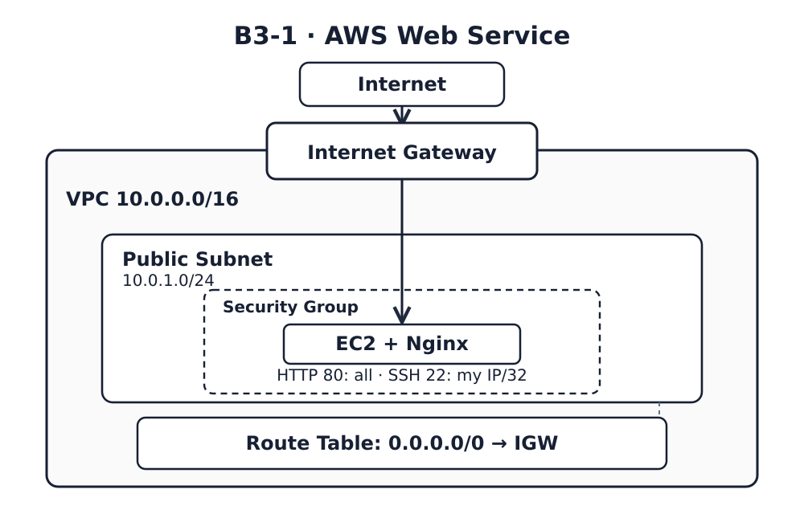

# B3-1 — 내가 만든 웹사이트를 인터넷에 올려 누구나 쓰게 하기

AWS 서울 리전(`ap-northeast-2`)에 VPC, Public Subnet, Internet Gateway, Route Table, EC2 1대, Security Group과 Nginx를 구성하는 필수 실습입니다. **보너스(HTTPS, Docker)는 제외**했습니다.

> **진행 상태:** CloudFormation 템플릿·IAM 정책·다이어그램·검증 및 학습 자료 작성. **AWS 실배포, 외부 접속 스크린샷, 실제 장애 기록, 과금 리소스 삭제는 아직 검증하지 않았습니다.** 코드 준비와 실습 완료를 구분합니다.

## 미션 제출물

| 필수 결과물 | 위치 | 상태 |
|---|---|---|
| 아키텍처 | [docs/architecture.svg](docs/architecture.svg) (편집 원본: [architecture.dot](docs/architecture.dot)) | 구성도 작성 |
| 외부 접속 | 이 문서 + `docs/screenshots/external-health.png` | **실제 검증·스크린샷 필요** |
| 트러블슈팅 | [docs/troubleshooting.md](docs/troubleshooting.md) | 절차/양식 작성, **실제 오류 검증 필요** |
| 리소스 정리 | [docs/cleanup-checklist.md](docs/cleanup-checklist.md) | 점검 항목 작성, **실제 삭제 확인 필요** |



## 주요 구현

- `template.yaml`: VPC(`10.0.0.0/16`), Public Subnet(`10.0.1.0/24`), `0.0.0.0/0 -> IGW`, `t3.micro` + Amazon Linux 2023 + Nginx, EBS gp3 8GiB, Public IPv4.
- 보안 그룹: 인바운드 HTTP 80(`0.0.0.0/0`), SSH 22(실습자 IPv4 `/32`)만 허용. 전체 포트 공개 금지.
- `iam/least-privilege-policy.json`: 실습 IAM 사용자 1명에게 서울 리전 EC2/VPC 작업과 `b3-1` CloudFormation 스택에 필요한 권한만 부여. `AdministratorAccess` 사용 금지.
- `scripts/verify.sh`: SSH 연결 → cloud-init/Nginx/localhost 200 → 인터넷 아웃바운드 → 외부 /health 200/OK를 검증.
- Elastic IP·NAT Gateway·ALB·RDS 미사용. 실습 종료 후 CloudFormation 스택 삭제.

## 실제 AWS 실행

사전조건: **루트가 아닌 기존 관리자 IAM 사용자**가 실습 IAM 사용자 `b3-1-lab`에 [제한 정책](iam/least-privilege-policy.json)을 부여하고, 로컬 AWS CLI 프로필(`b3-1`)과 서울 리전 SSH 키페어(`b3-1`)를 준비해야 합니다. 자격 증명과 .pem 파일은 Git에 올리지 않습니다. 자세한 단계는 [docs/deployment.md](docs/deployment.md)를 따릅니다.

```bash
export AWS_PROFILE=b3-1
MY_IP=$(curl -fsS https://checkip.amazonaws.com | tr -d '\r\n')
aws cloudformation validate-template --region ap-northeast-2 --template-body file://template.yaml
aws cloudformation create-stack --region ap-northeast-2 --stack-name b3-1 \
  --template-body file://template.yaml \
  --parameters ParameterKey=KeyName,ParameterValue=b3-1 \
               ParameterKey=SshCidr,ParameterValue="$MY_IP/32"
aws cloudformation wait stack-create-complete --region ap-northeast-2 --stack-name b3-1
bash scripts/verify.sh ~/.ssh/b3-1.pem
```

### 외부 접속 증빙 — 방식 B: GET /health

| 검증 항목 | 실제 결과 |
|---|---|
| URL | **미배포 — 실제 퍼블릭 IP 필요** |
| HTTP 상태·본문 | **미검증** (기대: HTTP 200, `OK`) |
| 검증 일시 | 미실행 |
| 스크린샷 | 미첨부 — `docs/screenshots/external-health.png` |

반드시 **EC2 외부 PC에서** `curl -i http://<PUBLIC_IP>/health`를 실행하고, 실제 URL/응답을 이 표에 기록하고 캡처합니다. 기대 응답을 실제 결과로 기재하지 마세요.

### 실습 후 과금 방지

```bash
aws cloudformation delete-stack --region ap-northeast-2 --stack-name b3-1
aws cloudformation wait stack-delete-complete --region ap-northeast-2 --stack-name b3-1
```

스택 삭제 뒤 EC2/EBS/EIP/IGW/VPC 및 별도 생성한 키페어·IAM 사용자를 점검하고 [체크리스트](docs/cleanup-checklist.md)에 결과를 적습니다. Billing 반영은 지연될 수 있습니다.

## 학습 경로

1. [개념](docs/concepts.md) — VPC, CIDR, 라우팅, SG, IAM, EC2, EBS
2. [구현 해설](docs/how-it-works.md) + [템플릿](template.yaml) — 시작부터 종료까지 요청·데이터 흐름
3. [배포 절차](docs/deployment.md) 및 [장애 분석](docs/troubleshooting.md)
4. [설명 대비 Q&A](docs/evaluation.md)

로컬 정적 검사: `python -m pip install PyYAML` 후 `python -m unittest discover -s tests -v` (AWS 실배포를 대신하지 않음).

**비용 주의:** 프리 티어 혜택은 계정 생성 시기 및 사용량에 따라 달라지고, 퍼블릭 IPv4·EBS·데이터 전송이 과금될 수 있습니다. [AWS EC2 Free Tier](https://docs.aws.amazon.com/AWSEC2/latest/UserGuide/ec2-free-tier-usage.html), [VPC 요금](https://aws.amazon.com/vpc/pricing/)을 확인하세요.
