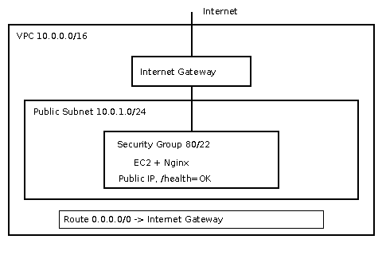

# B3-1 — AWS 웹 서비스 배포

AWS 서울 리전(`ap-northeast-2`)에서 네트워크를 구성하고 EC2에 Nginx를 배포해 외부 HTTP 접속을 검증한 실습이다. 실제 구축은 **AWS 콘솔에서 수동으로 진행**했으며, 검증 후 실습 리소스를 삭제했다.

## 구성

```text
인터넷 사용자
   │ HTTP :80
Internet Gateway
   │
VPC 10.0.0.0/16
   └─ Public Subnet 10.0.1.0/24
      └─ EC2 (Amazon Linux 2023, t3.micro)
         ├─ Security Group: HTTP 80 전체 / SSH 22 실습자 IP만
         └─ Nginx: / → HTML, /health → OK
```

- **라우팅:** Public Subnet의 Route Table에 `0.0.0.0/0 → Internet Gateway`를 연결했다.
- **IAM:** `b3-1-lab` 사용자에 실습 범위의 정책을 적용했고, 누락된 SG 조회 권한을 수정했다. 인프라 구축은 IAM 사용자로 진행했으며 초기 계정 관리(IAM 사용자 생성·삭제)는 Root 로그인으로 처리했다.
- **스토리지:** EC2 루트 EBS `gp3 8GiB`, 인스턴스 종료 시 삭제 설정.



## 검증 결과

| 검증 | 실제 결과 |
|---|---|
| EC2 접속 | Windows WSL Ubuntu에서 SSH 로그인 성공 |
| 서버 내부 | `cloud-init: done`, Nginx `active`, `localhost/health` → HTTP 200 / `OK` |
| 인터넷 아웃바운드 | EC2에서 `https://example.com` → HTTP 200 |
| 외부 접속 | 브라우저에 **Hello Cloud - B3-1** 표시, WSL의 `GET /health` → HTTP 200 / `OK` |

- **외부 접속 검증 방식 A:** 실습 당시 `http://3.35.220.184/`에서 페이지 표시. [화면 캡처](docs/screenshots/external-page.png)
- **추가 방식 B:** [외부 HTTP 응답 기록](docs/evidence/external-health.txt), [서버 내부 검증 기록](docs/evidence/internal-checks.txt)
- **검증 일시:** 2026-10-26 08:00 KST 전후. **현재는 인스턴스를 삭제하여 URL로 접속할 수 없다.**

## 결과물과 문서

| 파일 | 내용 |
|---|---|
| [docs/architecture.png](docs/architecture.png) | VPC·서브넷·IGW·EC2·SG·트래픽 흐름 |
| [docs/screenshots/external-page.png](docs/screenshots/external-page.png) | 브라우저 외부 접속 증빙 |
| [docs/troubleshooting.md](docs/troubleshooting.md) | 실제 IAM 권한 오류의 분석과 해결 |
| [docs/cleanup-checklist.md](docs/cleanup-checklist.md) | 리소스별 삭제 확인과 비용 점검 |
| [docs/guide.md](docs/guide.md) | 핵심 개념, 구성 이유, 실행·검증 흐름 |
| [docs/evaluation.md](docs/evaluation.md) | 주요 기능과 개념에 대한 설명 자료 |

## 코드와 재현

`template.yaml`은 같은 구성을 선언한 **CloudFormation 재현용 템플릿**이고, `iam/least-privilege-policy.json`은 사용한 제한 정책의 소스다. 이번 실제 배포에서는 CloudFormation을 실행하지 않았다. `scripts/verify.sh`도 **CloudFormation 스택의 Outputs를 읽는 대안 경로 전용**이므로 수동 배포에 바로 사용할 수 없다.

실습 절차와 접속·검증 명령은 [구현 가이드](docs/guide.md)에 정리했다. 템플릿의 정적 검사는 Python과 PyYAML 설치 후 다음과 같이 실행한다(실제 AWS 배포 검증과는 다름).

```bash
python -m unittest discover -s tests -v
```

## 정리와 비용

EC2/EBS, 실습 VPC·서브넷·IGW·라우팅·보안 그룹, AWS 키 페어, IAM 사용자·정책 삭제를 확인했다. WSL 개인 키도 삭제했으며 Windows 원본 키도 제거했다.

2026-10-26 08:37 KST에 확인한 **10월 예상 청구액은 USD 0.00**이었다. 최종 청구는 당시 미확정이고 Elastic IP·NAT Gateway·Load Balancer·RDS 목록의 별도 잔여 조회는 수행하지 않았다. 자세한 결과는 [정리 체크리스트](docs/cleanup-checklist.md)에 기록했다.
