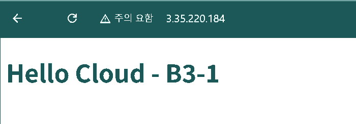

# B3-1 — 내가 만든 웹사이트를 인터넷에 올려 누구나 쓰게 하기

AWS 서울 리전(`ap-northeast-2`)에 **VPC → Public Subnet → Internet Gateway/Route Table → Security Group → EC2/Nginx**를 연결하고 외부에서 HTTP로 접속하는 미션입니다. 보너스 과제(HTTPS/Docker)는 제외했습니다.

> **실제 실습 상태 (2026-10-26 KST):** AWS 콘솔에서 직접 VPC/서브넷/IGW/라우팅/SG/EC2/Nginx를 만들고 SSH·내부 HTTP 200·아웃바운드 HTTP 200·브라우저 접속·외부 `/health` HTTP 200/`OK`를 확인했습니다. **실습 리소스 삭제는 아직 확인되지 않았습니다.** 이 저장소의 CloudFormation 템플릿은 별도의 재현용 예제이며 실제 실습은 콘솔 수동 경로 A로 진행했습니다.

## 먼저 이것부터: 서버가 켜졌는데 밖에서 접속이 안 되는 이유

웹서비스가 실제로 열리려면 **서로 다른 네 가지 문제**가 해결되어야 합니다.

1. **서버 자체:** EC2가 실행되고 Nginx가 HTTP에 응답해야 합니다.
2. **찾아갈 주소:** EC2에 퍼블릭 IPv4가 있어야 합니다.
3. **인터넷 경로:** Public Subnet에 IGW를 향하는 Route Table 경로가 적용되어야 합니다.
4. **접근 허용:** Security Group에서 웹 접속용 TCP 80을 열어야 합니다. SSH 22는 내 IP/32만 허용합니다.

IAM은 이 네트워크 흐름과는 별도로 **누가 AWS 자원을 생성/수정할 수 있는가**를 결정합니다. 이 관계를 이해하는 것이 B3-1의 핵심입니다.


## 공부를 어떻게 하면 좋을까?

**처음에는 내용을 통째로 암기하지 말고, 아래 순서대로 질문에 답하면서 읽으세요.**

| 읽는 순서 | 문서 | 무엇을 이해하게 되나? |
|---|---|---|
| 1 | **[개념 교재](docs/concepts.md)** | "EC2만으로 왜 안 되지?"에서 시작해 IP, VPC, 라우트, SG, IAM이 등장한 이유를 **하나의 이야기**로 학습 |
| 2 | **[AWS 콘솔 따라 하기](docs/deployment.md)** | 화면에서 직접 생성할 때 각 단계의 **이유 → 설정 → 관찰 결과** 확인 |
| 3 | **[구현 흐름 해설](docs/how-it-works.md)** | 손으로 만든 설정이 `template.yaml`의 어느 코드와 대응하는지, 실행부터 HTTP 응답까지 추적 |
| 4 | **[문제 해결 실습](docs/troubleshooting.md)** | 404, 타임아웃, SSH 실패를 구분하고 실제 로그로 가설을 검증 |
| 5 | **[설명 연습 Q&A](docs/evaluation.md)** | 다른 사람 앞에서 코드를 가리키며 **왜 그렇게 구성했는지** 자신의 말로 설명 |
| 마지막 | **[리소스 정리](docs/cleanup-checklist.md)** | 인스턴스 종료와 실제 비용 자원 삭제의 차이 이해 및 정리 기록 |

**추천 학습법:** 개념 한 장을 읽고 → 콘솔에서 해당 설정을 만든 다음 → `template.yaml`의 같은 설정을 찾아보세요. 예를 들어 Public Subnet의 라우트 연결을 화면에서 확인한 직후 `PublicRouteAssociation` 코드를 읽으면 역할이 분명해집니다.

## 실제 실습 경로: 둘 중 하나만 선택

- **경로 A — AWS 콘솔 수동 실습(첫 학습 추천):** [docs/deployment.md](docs/deployment.md)의 경로 A를 따라 VPC, 라우팅, SG, EC2를 각각 만듭니다. **CloudFormation 스택이 없으므로 수동으로 삭제**해야 합니다.
- **경로 B — CloudFormation 배포:** 기존 [template.yaml](template.yaml)과 [검증 스크립트](scripts/verify.sh)로 일괄 생성합니다. 연결을 이해한 뒤 재현할 때 유용합니다. `verify.sh`는 스택 `b3-1`의 Outputs를 읽으므로 **경로 A에서는 사용할 수 없습니다.**

**두 경로를 동시에 실행하면 EC2와 VPC가 중복 생성될 수 있으니 피하세요.** 계정의 프리 티어/크레딧 조건과 퍼블릭 IPv4 비용을 시작 전에 확인해야 합니다.

## 실제 구현 요소와 파일

| 파일 | 역할 |
|---|---|
| [template.yaml](template.yaml) | AWS VPC `10.0.0.0/16`, Subnet `10.0.1.0/24`, IGW/기본 경로, SG, `t3.micro`+Nginx, gp3 8GiB 정의 |
| [iam/least-privilege-policy.json](iam/least-privilege-policy.json) | 실습 IAM 사용자에게 적용한 제한 정책의 소스. 실제 AWS에서 누락된 SG 조회 권한을 보완하여 정책 버전 2로 적용 |
| [scripts/verify.sh](scripts/verify.sh) | CloudFormation 경로 전용: 인스턴스/SSH/Nginx/localhost/아웃바운드/외부 접속 검사 |
| [docs/architecture.png](docs/architecture.png) | 미션 제출용 아키텍처 그림 ([편집 가능한 SVG](docs/architecture.svg)) |
| [tests/test_template.py](tests/test_template.py) | 템플릿 구조 정적 검사. AWS 실배포 검증과는 다름 |

정적 검사(로컬에 Python, PyYAML이 있는 경우):

```bash
python -m pip install PyYAML
python -m unittest discover -s tests -v
```

## 실제 배포 결과 및 미션 제출 증빙 (2026-10-26)

**배포 경로:** AWS 콘솔 수동 생성 (경로 A). CloudFormation 스택은 사용하지 않았습니다.

| 리소스 | 확인된 값 |
|---|---|
| 리전 | `ap-northeast-2` (서울) |
| VPC | `b3-1-vpc` · `vpc-092e559c4035289db` · `10.0.0.0/16` |
| Public Subnet | `b3-1-public-subnet` · `subnet-078b1593e96abeeb0` · `10.0.1.0/24` |
| IGW | `b3-1-igw` · `igw-00435840b6f0950ae` · VPC 연결 |
| Route Table | `b3-1-public-route` · `rtb-0476ec11e4a44b4af` · `0.0.0.0/0 → IGW` |
| Security Group | `b3-1-web-sg` · `sg-0f6063dfd511ae455`; HTTP 80 전체, SSH 22 개인 IP/32 |
| EC2 | `b3-1-web` · `i-0fe03d78532fbbe17` · `t3.micro` · Amazon Linux 2023 |
| 퍼블릭 IPv4 (검증 당시) | `3.35.220.184` (리소스 종료 시 사용 불가) |
| IAM | `b3-1-lab` 사용자 / `b3-1-lab-policy` 기본 버전 2 |

### 외부 접속 제출 방식: **A — 브라우저 접속**

- URL: `http://3.35.220.184/`
- 실제 화면: **Hello Cloud - B3-1** 표시 확인.
- 증빙: [실제 브라우저 화면 캡처](docs/screenshots/external-page.png). 사용자 제공 원본의 **주소창과 웹페이지 영역을 크롭하고 색상 수를 줄인 사본**입니다. 임의로 웹페이지를 재구성한 그림이 아닙니다.



### 추가 검증: **B — WSL Ubuntu의 외부 GET /health**

- 명령: `curl -i --connect-timeout 10 --max-time 20 http://3.35.220.184/health`
- 결과: **HTTP/1.1 200 OK**, 본문 **OK**.
- 서버 Date 응답: **2026-10-25 23:00:10 GMT** (한국시간 **2026-10-26 08:00:10 KST**).
- 실제 터미널 출력: [외부 HTTP 검증 로그](docs/evidence/external-health.txt).
- 내부 Nginx/SSH/아웃바운드 실제 출력: [내부 검증 로그](docs/evidence/internal-checks.txt).

**주의:** B 방식은 터미널 원문으로 증빙했고, 화면 스크린샷은 A 방식에 해당합니다. 선택한 필수 제출 방식은 **A**입니다.

### 필수 제출물 현황

| 필수 결과물 | 파일 | 상태 |
|---|---|---|
| 아키텍처 | [docs/architecture.png](docs/architecture.png) | 작성 완료 |
| 외부 접속 증빙 | README의 방식 A URL 및 [브라우저 캡처](docs/screenshots/external-page.png) | **실제 확인 완료** |
| 트러블슈팅 | [docs/troubleshooting.md](docs/troubleshooting.md) | **실제 IAM 권한 오류 → 정책 수정 → 배포 성공 기록** |
| 리소스 정리 | [docs/cleanup-checklist.md](docs/cleanup-checklist.md) | **미완료: 실제 AWS 삭제·확인 필요** |

**실제 정리 진행 기록 (2026-10-26 KST):** EC2 `i-0fe03d78532fbbe17`의 AWS 콘솔에서 '종료(삭제) 처리됨' 메시지를 확인했습니다. 그러나 EC2 목록에는 `running` 필터가 적용되어 있어 `terminated` 상태 자체는 아직 확인하지 못했습니다. EBS `vol-0eb866e2e013ed6f3` (gp3, 8 GiB)는 다음 화면에 여전히 표시됐으며 현재 상태와 연결 여부가 보이지 않아 실제 삭제 여부는 **미확인**입니다. 잔여 볼륨 및 네트워크 정리 완료로 표시하지 않습니다.

## 안전과 비용

루트 계정과 `AdministratorAccess`를 실습에 사용하지 않습니다. SSH 22는 현재 본인의 퍼블릭 IP 한 개만 허용하고, 비밀번호·AWS 액세스 키·SSH 개인 키는 절대 저장소에 올리지 않습니다.

AWS의 Free Tier 혜택은 계정 생성 시기와 계정 플랜에 따라 다릅니다. EC2뿐 아니라 EBS, 퍼블릭 IPv4, 네트워크 전송도 살펴봐야 합니다. 자세한 확인 절차는 실습서에 있습니다.

공식 근거: [AWS VPC 인터넷 연결](https://docs.aws.amazon.com/ko_kr/vpc/latest/userguide/VPC_Internet_Gateway.html), [AWS EC2 Free Tier 조건](https://docs.aws.amazon.com/ko_kr/AWSEC2/latest/UserGuide/ec2-free-tier-usage.html).
